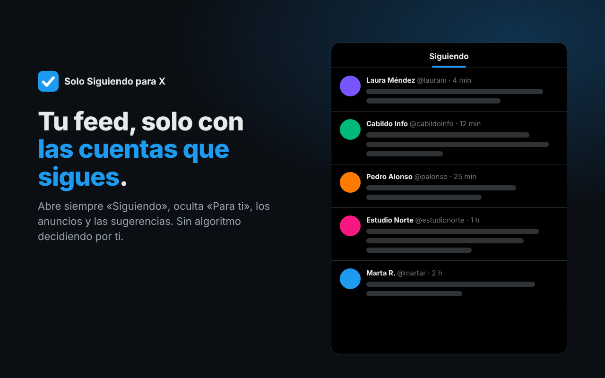

# Solo Siguiendo para X

Extensión de Chrome que limita el feed de X (Twitter) a las cuentas que sigues.

- Abre siempre la pestaña **Siguiendo** en lugar de **Para ti**.
- Oculta la pestaña **Para ti**.
- Oculta los posts promocionados (anuncios).
- Oculta «A quién seguir» y las tendencias.
- Opcional: oculta los reposts, que suelen traer contenido de cuentas que no sigues.

Cada opción se activa o desactiva desde el icono de la extensión y se aplica al momento.



## Instalación

**Desde la Chrome Web Store:** _(enlace cuando esté publicada)_

**Manual (modo desarrollador):**

1. Descarga este repositorio (`Code → Download ZIP`) y descomprímelo.
2. Abre `chrome://extensions` y activa el **Modo de desarrollador**.
3. Pulsa **Cargar descomprimida** y elige la carpeta `extension`.
4. Recarga x.com.

## Privacidad

La extensión no recoge, envía ni guarda ningún dato personal. Solo guarda tus preferencias (qué opciones tienes activadas) en el almacenamiento de Chrome. Consulta la [política de privacidad](PRIVACY.md).

## Si deja de funcionar

X cambia su web de vez en cuando. Si algo deja de ocultarse, abre un [issue](https://github.com/GofioDesign/X-only-following/issues) indicando qué ves.

## Publicar una versión nueva

```bash
./build.sh   # genera dist/solo-siguiendo-x-<versión>.zip listo para la Web Store
```

## Licencia

[MIT](LICENSE) © Gofio Design

---

_Proyecto independiente, sin relación con X Corp._
